# Multi-Mode DreamBooth

<table width="100%">
  <tr>
    <th align="center">Mode (2)</th>
    <th align="center">Mode (2)</th>
    <th align="center">Mode (1)</th>
  </tr>

  <!-- Row 1: images -->
  <tr>
    <td align="center" width="33%">
      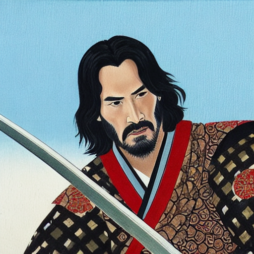
    </td>
    <td align="center" width="33%">
      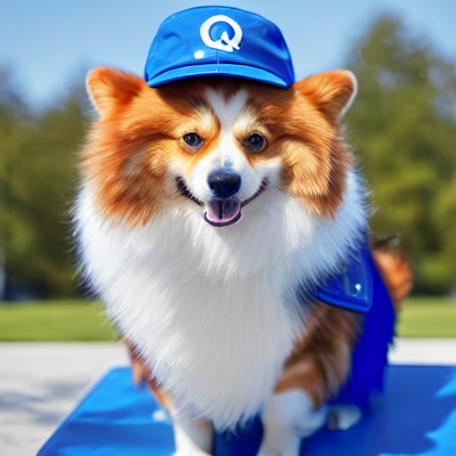
    </td>
    <td align="center" width="33%">
      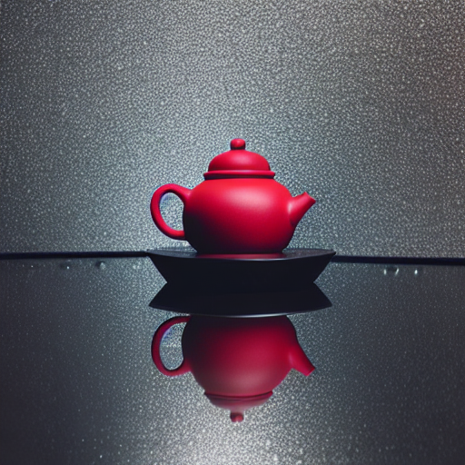
    </td>
  </tr>

  <!-- Row 2: captions -->
  <tr>
    <td align="center" width="33%">
      A Japanese-style painting of &lt;q5xv&gt; person as a samurai
    </td>
    <td align="center" width="33%">
      a photo of &lt;q5xv&gt; dog with blue hat
    </td>
    <td align="center" width="33%">
      a moody studio photo of &lt;q5xv&gt; teapot sitting on a wet reflective surface, soft rain droplets, neon rim lighting, dark background, cinematic contrast, ultra-detailed, professional product photography, bokeh highlights
    </td>
  </tr>
</table>

## Introduction
This repository provides a clean implementation of DreamBooth from scratch with several modes. DreamBooth is a technique for fine-tuning text-to-image diffusion models (e.g., Stable Diffusion) on a specific subject using only a few reference images. The code has a simple CLI for training and inference is easy to extend and customize.

The implemented DreamBooth supports three modes:
1. Fine-tune ***only*** the diffusion model (UNet component)
2. Fine-tune the UNet component alongside the ***entire text encoder***
3. Fine-tune the UNet component alongside a straightforward implementation of ***Textual Inversion***, which adds a single special token to the tokenizer and trains only the corresponding row in embedding table of the text encoder 

Each mode has its own pros and cons. Based on experiments:
- Mode (1) works well for rigid objects such as teapots and maintains good diversity and accuracy, since the text encoder is left untouched.
- Mode (2) performs better for more complex and deformable subjects such as humans, dogs, and toys.
- Mode (3) was implemented out of curiosity by combining DreamBooth and Textual Inversion techniques. Experiments showed that it does not preserve subject identity.

## Quick Installation

### 1. Create a virtual environment

``` bash
make venv
```

### 2. Activate it

``` bash
source .venv/bin/activate
```

### 3. Install Dependencies and CUDA-Enabled PyTorch

``` bash
make install-gpu
make install-dev
```
If you want to change the version of cuda enabled torch (currently CUDA 12.8), you can modify install-gpu section in `Makefile`.

### 4. Verify GPU support

``` bash
make check-gpu
```

## How To Use

Check supported commands and their options:
```
dreambooth --help
dreambooth train --help
dreambooth infer --help
```

For **examples** of how to use ```dreambooth train``` and ```dreambooth infer```, as well as some generated images, please see the ***```sample``` folder***.

In the `samples` directory, you can find links to the images used in the experiments. If you want to train on your own data, you can follow the same structure and setup used in the samples.

Experiments show that choosing good hyperparameters is essential for achieving high-quality results. Additionally, it is recommended to generate multiple samples for each prompt to increase the probability of obtaining a good output. Finally, a well-crafted and expressive prompt is highly important. Very short or overly complicated prompts usually ***do not perform*** nearly as well as clear, descriptive ones.

## Example Results

- For the commands used for training and inference, see, see `sample_runs/dog`:

| Item 1 | Item 2 | Item 3 |
|--------|--------|--------|
| 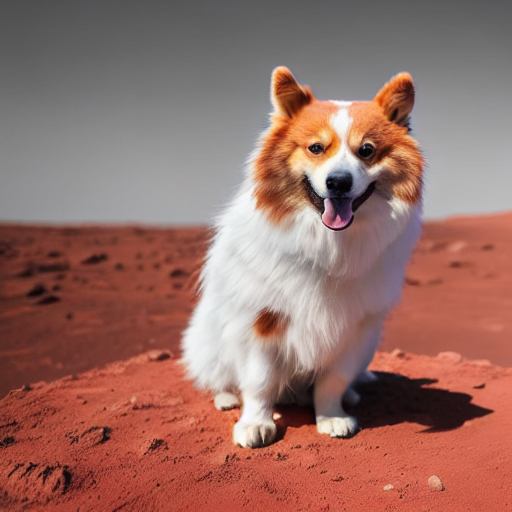<br>**a high-resolution photo of \<q5xv\> dog standing on the surface of Mars, dramatic red landscape, sharp details** | 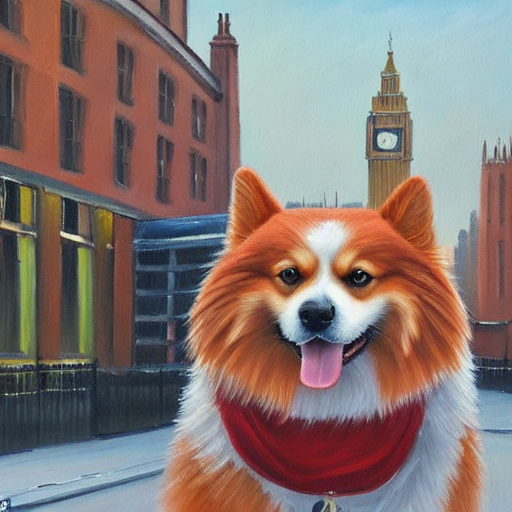<br>**a detailed oil painting of \<q5xv\> dog in London, Big Ben in the background, rich colors, artistic brush strokes** | 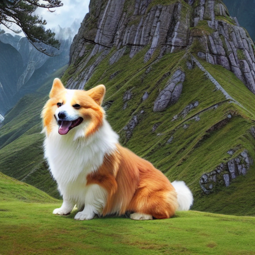<br>**\<q5xv\> dog in Middle Earth, epic fantasy scenery, lush green valleys, Tolkien style** |
| 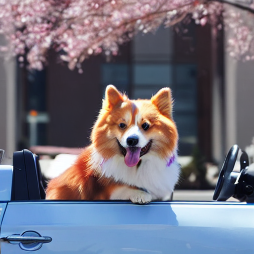<br>**a photo of \<q5xv\> dog driving a car** | 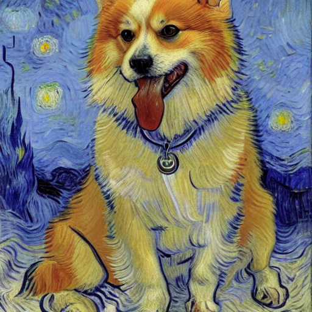<br>**a Van Gogh painting of \<q5xv\> dog** | 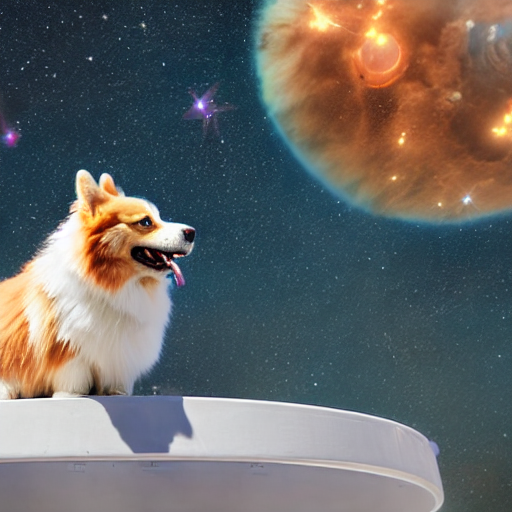<br>**\<q5xv\> dog floating in outer space, stars and nebulae in the background, cinematic lighting** |

- For the commands used for training and inference, see, see `sample_runs/red_cartoon`:

| Item 1 | Item 2 | Item 3 |
|--------|--------|--------|
| 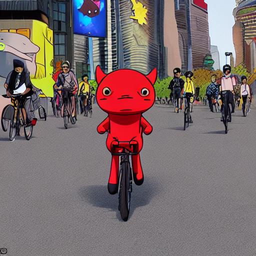<br>**a photo of \<q5xv\> cartoon riding a bicycle.** | 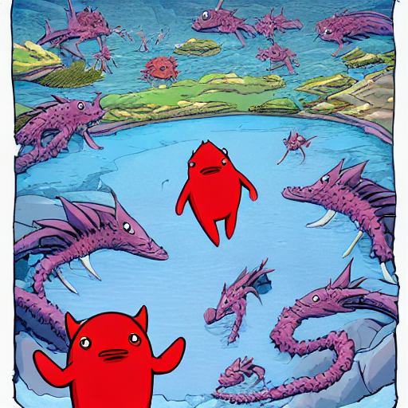<br>**a photo of \<q5xv\> cartoon in bottom of ocean near coral cliff.** | 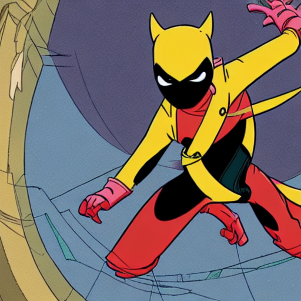<br>**a \<q5xv\> cartoon dressed as Ninja** |
| 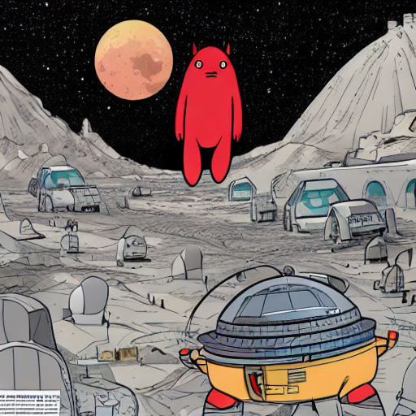<br>**a photo of \<q5xv\> cartoon on Moon** | 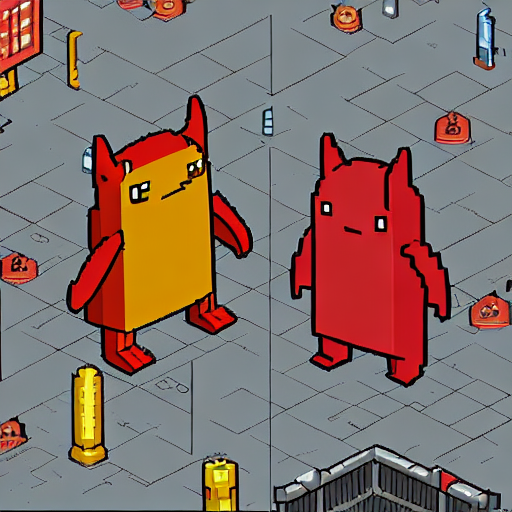<br>**a pixel art of \<q5xv\> cartoon** | 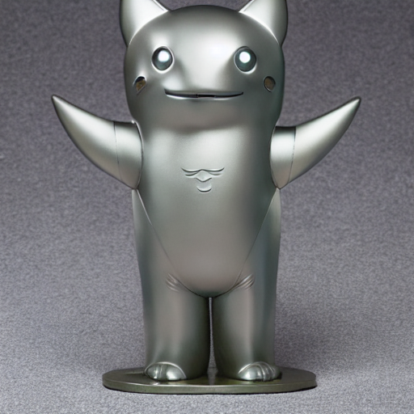<br>**a photo of metalic statue of \<q5xv\> cartoon** |

- For the commands used for training and inference, see, see `sample_runs/monster_toy`:

| Item 1 | Item 2 | Item 3 |
|--------|--------|--------|
| 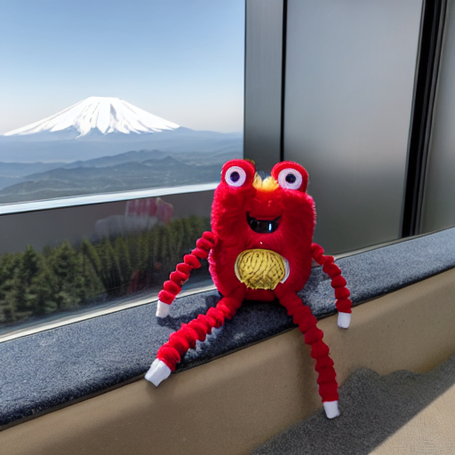<br>**a photo of \<q5xv\> toy on top of mount Fuji** | 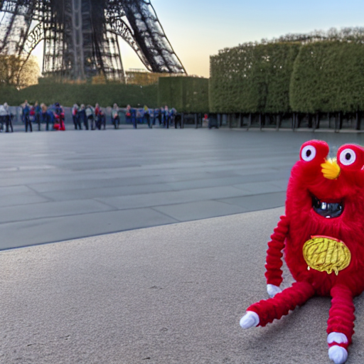<br>**a photo of \<q5xv\> toy in front of Eiffel tower.** | 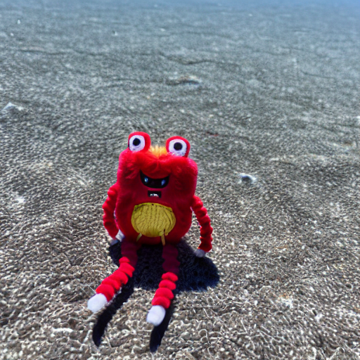<br>**a photo of \<q5xv\> toy in ocean.** |
| 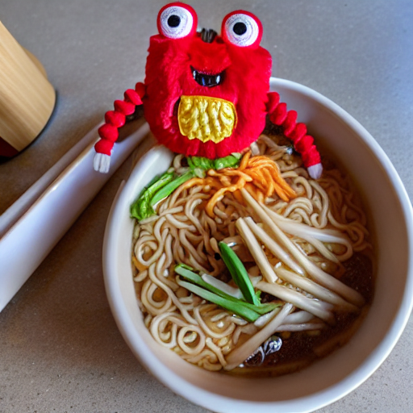<br>**a photo of \<q5xv\> toy in ramen bowl.** | 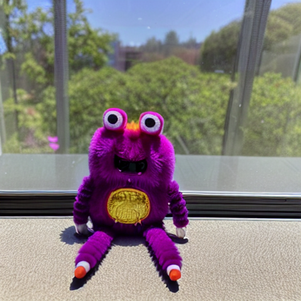<br>**a photo of \<q5xv\> toy with purple fur** | 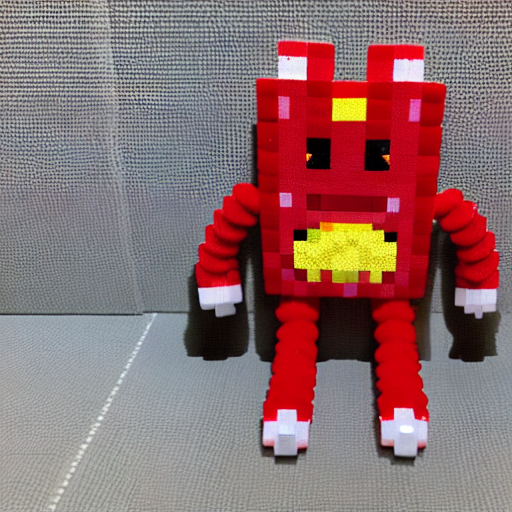<br>**a pixel art of \<q5xv\> toy** |


- For the commands used for training and inference, see, see `sample_runs/teapot`:

| Item 1 | Item 2 | Item 3 |
|--------|--------|--------|
| 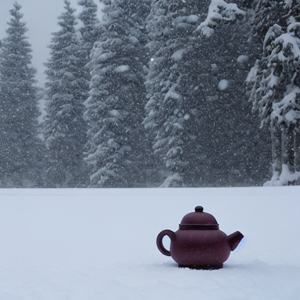<br>**a photo of \<q5xv\> teapot in snow.** | 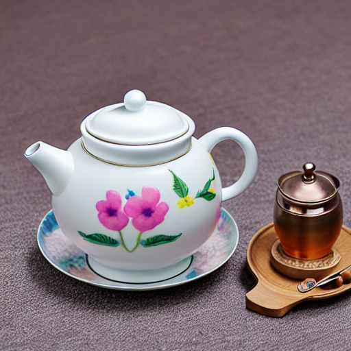<br>**a photo of \<q5xv\> teapot with flower design.** | 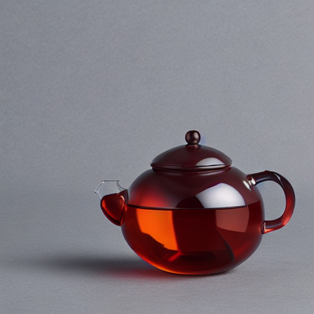<br>**a \<q5xv\> teapot made of glass.** |

- For the commands used for training and inference, see, see `sample_runs/face1`:

| Item 1 | Item 2 | Item 3 |
|--------|--------|--------|
| 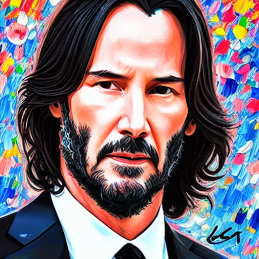<br>**a detailed oil painting of \<q5xv\> person, rich colors, artistic brush strokes.** | 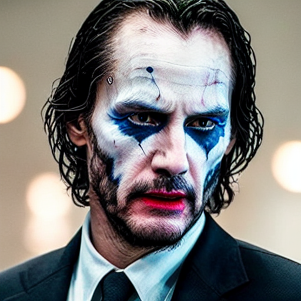<br>**a photo of \<q5xv\> person with makeup of the joker from the Dark Knight movie.** | 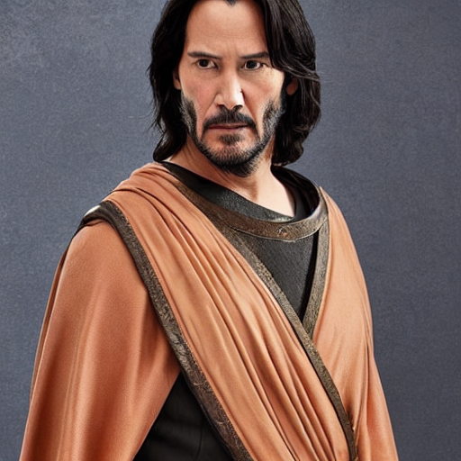<br>**a photo of \<q5xv\> person dressed as a roman emperor.** |
| 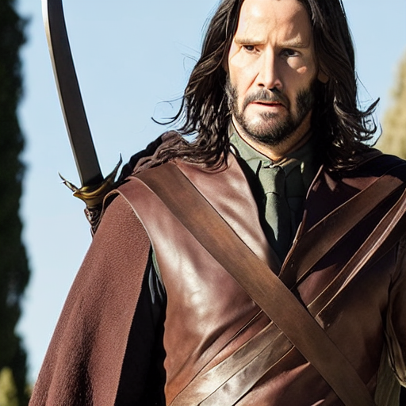<br>**a photo of \<q5xv\> person dressed as Aragorn form lord of the ring universe.** | <br>**a portrait of \<q5xv\> person with green hair.** | <br>**A portrait of \<q5xv\> person inside a vintage cafe.** |

## License
Released under the MIT License. For pretrained models or datasets, please check their respective licenses.

## References
```
- Ruiz, Nataniel, Yuanzhen Li, Varun Jampani, Yael Pritch, Michael Rubinstein, and Kfir Aberman. "Dreambooth: Fine tuning text-to-image diffusion models for subject-driven generation." In Proceedings of the IEEE/CVF conference on computer vision and pattern recognition, pp. 22500-22510. 2023.

- Gal, Rinon, Yuval Alaluf, Yuval Atzmon, Or Patashnik, Amit H. Bermano, Gal Chechik, and Daniel Cohen-Or. "An image is worth one word: Personalizing text-to-image generation using textual inversion." arXiv preprint arXiv:2208.01618 (2022).
```